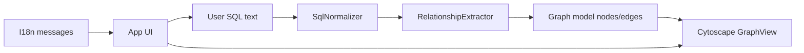

# Architecture

QueryAnalyzer is a static single-page application by **William Marques** ([github.com/wem1982](https://github.com/wem1982)). All behavior runs in the browser; there is no build step and no server-side component. Licensed under MIT with required attribution (see [LICENSE](../LICENSE)).

## High-level flow



1. **Input** — The user pastes exactly one query into the textarea.
2. **Normalize** — Comments are stripped and whitespace collapsed while preserving string literals.
3. **Extract** — Tables, aliases, CTEs, and join predicates become a graph model.
4. **Render** — Cytoscape lays out nodes and directed, labeled edges.
5. **i18n** — UI strings and join labels follow the active locale (`en` | `pt`).

## Module boundaries

| Module | Responsibility |
|--------|----------------|
| `src/js/i18n/messages.js` | Locale dictionaries and DOM `data-i18n` binding |
| `src/js/parser/sql-normalizer.js` | Safe preprocessing of raw SQL text |
| `src/js/parser/relationship-extractor.js` | FROM/JOIN/WITH parsing → `{ nodes, edges }` |
| `src/js/graph/cytoscape-view.js` | Maps model to Cytoscape elements and styles |
| `src/js/app.js` | Events, stats, empty states, theme, persistence |
| `src/js/main.js` | `DOMContentLoaded` bootstrap |

Scripts load in dependency order from `index.html`. Each file attaches to the global `QueryAnalyzer` namespace to avoid ES module restrictions when opening the app from disk.

## Graph model

### Nodes

- **Table** — Identifier from `FROM` / `JOIN` (optionally `schema.table`).
- **Alias** — Node `id` and label prefer the SQL alias when present.
- **CTE** — Names declared in `WITH name AS (...)`.
- **Subquery** — Parenthesized `SELECT` without alias gets a generated id; with alias uses the alias.

### Edges

Each edge includes:

- `source`, `target` — Node ids
- `joinType` — `INNER` | `LEFT` | `RIGHT` | `FULL` | `CROSS` | `NATURAL` | `IMPLICIT`
- `conditions` — Column pairs from `ON` or equi-join predicates; `USING` columns marked with `using: true`

`IMPLICIT` edges come from `table.col = table.col` patterns in `WHERE` when both sides reference known table prefixes.

## Parser strategy

The extractor is **intentionally heuristic**, not a full SQL AST:

- Walks each **CTE body** and the **main query** after `WITH`, locating `FROM` / `JOIN` in each (stops at `WHERE`, `GROUP BY`, etc.).
- Walks explicit `JOIN` keywords longest-match-first (`LEFT OUTER JOIN` before `JOIN`).
- Splits comma-separated `FROM` lists only when no `JOIN` keyword appears in the fragment before the first join.
- Parses `ON` conditions by splitting on `AND` at parenthesis depth zero.
- Accepts equi-join predicates matching `qualified.col = qualified.col`.

This keeps the bundle small and dependency-free while covering typical reporting queries.

## UI / UX

- **Workspace grid** — Editor left, graph right (stacked on narrow viewports).
- **Theme** — CSS variables in `variables.css`; `data-theme` on `<html>`.
- **Accessibility** — Semantic sections, `sr-only` labels, live region for relation list updates.

## Extension points

Reasonable future enhancements (not implemented):

- Dialect profiles (T-SQL backticks, PostgreSQL `$n`, etc.)
- Export graph as PNG / JSON
- Optional second panel for subquery drill-down

## Testing

Run a lightweight smoke test (Node.js optional):

```bash
node tests/parser-smoke.js
```

This validates the extractor on fixed fixtures without a browser.
